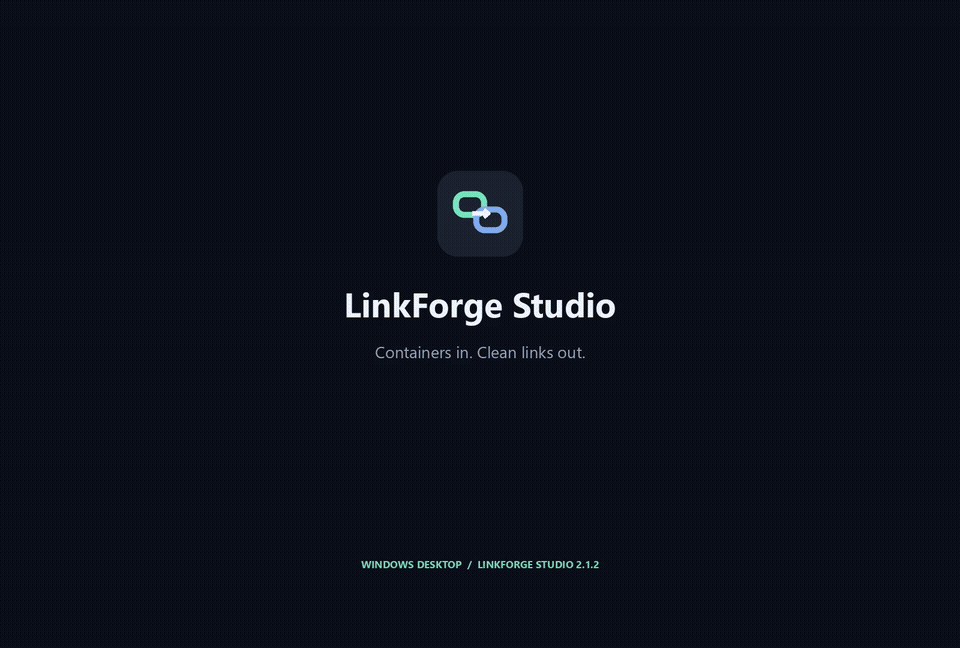

# LinkForge Studio

**Version 2.1.2 · Portable Windows x64 · Python / PySide6 (Qt)**

Turn named HTTP/HTTPS link lists into standard JDownloader `.dlc` containers, or extract links from existing containers. LinkForge Studio is a desktop link-list tool—not a downloader—and is not affiliated with JDownloader.


## Features

- Import `.dlc`, `.csv`, and `.txt` files, paste text, or drag and drop files.
- Create DLC containers and extract links from containers with multiple packages.
- Export CSV with `Title,Package,Link` columns or TXT with URLs.
- Keep original encoded URLs intact when opening, copying, or exporting; decoded URLs are for display only.
- Deduplicate entries by URL, name, and package; filter the view without limiting exported data.

## Getting started

1. Open the project's **Releases** and download the ZIP asset named `LinkForge-v2.1.2-windows-x64.zip` for the release you want.
2. Extract the **entire ZIP** into a folder. Keep `_internal/` next to the executable; do not move the executable alone.
3. Double-click **LinkForge Studio.exe**. Python is not required for the portable release.

The executable is unsigned, so Windows SmartScreen may show a warning. Only proceed if you trust the source of the ZIP; do not disable Windows protection globally.

Import or paste your links, choose a package name, and create a DLC—or import an existing DLC and export its links. Recompiling imported data flattens all entries into the single package name you choose.

**LinkForge does not download files itself.** Clicking a blue URL hands the original URL to your default browser, which may initiate a download.

### Input rules

- Only HTTP/HTTPS URLs are accepted; protocol-relative URLs beginning with `//` are normalized to `https://`.
- Arbitrary text can contain notes, which are ignored. Only `Name | URL` assigns a name in plain-text input.
- CSV uses `Title,Package,Link`; TXT export contains URLs only.
- A view filter does **not** restrict what is exported.

## Demo and examples



[Watch the MP4 demo](media/demo.mp4) · [TXT example](examples/sample-links.txt) · [CSV example](examples/sample-links.csv) · [DLC example](examples/demo.dlc)

All links shown in the media and checked-in examples are **illustrative placeholders** on `example.com`, `example.org`, or `example.net`. They are not real archive downloads and are not intended to demonstrate availability of downloadable content.

The silent, approximately 25-second video is a repeatable **scripted capture of the real Qt widgets**, with a presentation cursor overlay—not a recording of a personal desktop. It exercises TXT import, search/name editing, link actions, live DLC decryption, and both export actions. To regenerate it with a locally installed FFmpeg:

```powershell
python -m pip install -r requirements-demo.txt
python tools/make_demo.py --ffmpeg C:\path\to\ffmpeg.exe
```

DLC decryption in this demo needs internet. No hosted sample files or third-party music are downloaded. Screenshots and a video contact sheet are included under `media/`.

## Develop and build

Use **Python 3.10+**. From a clean repository root:

```powershell
python -m venv .venv
.\.venv\Scripts\Activate.ps1
python -m pip install -r requirements-build.txt
python qt_app.py
```

Run the tests:

```powershell
python -m unittest test_core test_container_io test_qt_app -v
```

Build the Windows executable:

```powershell
.\build.ps1
```

The PyInstaller one-directory build outputs `dist/LinkForge Studio/LinkForge Studio.exe` alongside `_internal/` dependencies in this clean repository. Distribute the whole output folder, not the executable alone. No legacy Studio folder is required. The portable ZIP is packaged separately in `../release/` as `LinkForge-v2.1.2-windows-x64.zip`.

The source includes `core.py`, `qt_app.py`, `ui_theme.py`, UI assets, asset-generation scripts, tests, and `tools/make_demo.py`. Runtime dependencies are listed in [requirements.txt](requirements.txt), build dependencies in [requirements-build.txt](requirements-build.txt), and optional demo dependencies in [requirements-demo.txt](requirements-demo.txt). Development and building do not require external online accounts; installing dependencies may require network access.

## Limits and privacy

DLC creation, decryption, and verification require the online key service at `https://service.jdownloader.org/dlcrypt/service.php`. LinkForge sends the container key/token to that service—not plaintext link lists. Service availability is outside this project's control.

**A DLC is not a private vault.** Treat containers, exported lists, and URLs (including embedded access tokens) as potentially sensitive. See [SECURITY.md](SECURITY.md).

- DLC input has a 64 MB safety limit.
- No private catalogs, target compatibility checks, CAPTCHA bypass, or archive-content checks are provided.
- Archive passwords are not embedded.
- Link availability and the contents of destinations are not guaranteed.

## License and contributions

Original LinkForge application code is licensed under the [MIT License](LICENSE), copyright © 2026 LinkForge contributors—not the entire bundled dependency stack. Qt/PySide6 and other dependencies retain their own licenses; see [THIRD_PARTY_NOTICES.md](THIRD_PARTY_NOTICES.md) and [LICENSES/](LICENSES/). The one-directory bundle keeps Qt shared libraries replaceable; you can also rebuild from source with replacement Qt/PySide6 libraries, subject to their licenses and compatibility.

See [CONTRIBUTING.md](CONTRIBUTING.md), [CHANGELOG.md](CHANGELOG.md), and [RELEASE_NOTES.md](RELEASE_NOTES.md).
