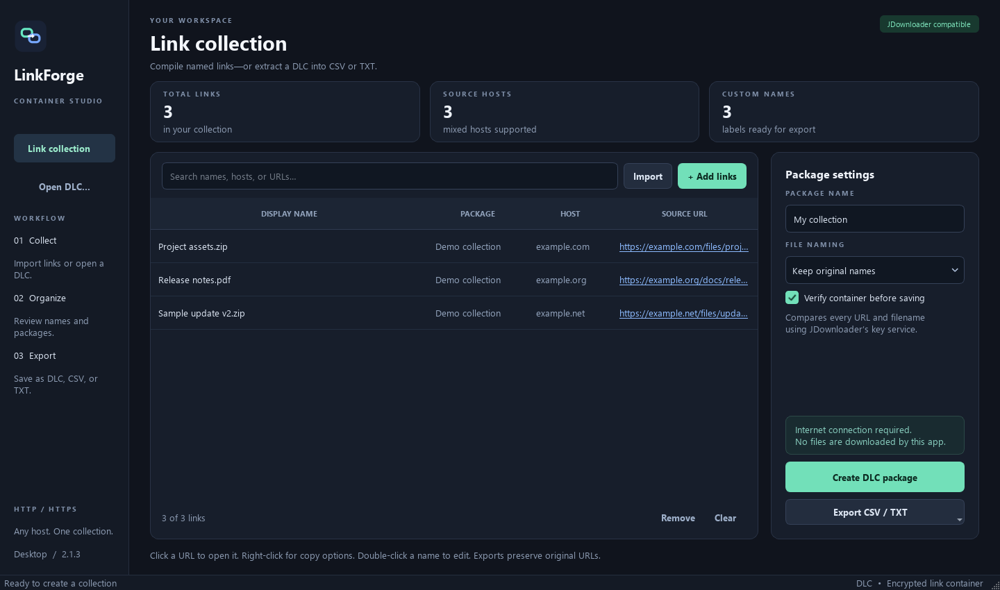

# LinkForge Studio

**Windows x64 · v2.1.3**

Create JDownloader DLC containers from named links, or open existing DLCs and export their links to CSV or TXT. General-purpose: not tied to any game, platform, or file host.



## Download

**[Download the Windows app](https://github.com/XD3V3LOP3RX/Linkforge/releases/latest)**

Extract the entire Windows ZIP and run **LinkForge Studio.exe**. Keep `_internal/` beside the EXE. No Python installation is needed. The executable is unsigned, so Windows SmartScreen may warn.

## Use

- Import DLC, CSV, or TXT; paste links; or drag files onto the window.
- Use `Name | https://example.com/file.zip` to name a pasted link. Text import ignores notes and accepts `//` links as HTTPS.
- Search and edit names, then create a DLC package or export CSV/TXT.
- CSV contains `Title,Package,Link`; TXT contains one original URL per line. Search does not limit exports.
- Click a blue URL to open it, or right-click to copy it. Readable display does not change the original encoded URL.

Multi-package DLC imports preserve source package names in the table and CSV. Creating a new DLC combines the collection into the package name you choose.

[Watch the short demo](media/demo.mp4). The video uses the same interface with illustrative placeholder links; it is not a recording of real downloads. The video was captured in v2.1.2; v2.1.3 keeps the same interface and features.

## Run from source

Requires Python 3.10+:

```powershell
python -m venv .venv
.\.venv\Scripts\Activate.ps1
python -m pip install -r requirements.txt
python qt_app.py
```

To build the Windows application:

```powershell
.\build.ps1
```

Output: `dist/LinkForge Studio/LinkForge Studio.exe`. Distribute the entire output folder, including its runtime libraries and license notices.

[qt_app.py](qt_app.py) contains the interface and styling; [core.py](core.py) handles links, DLCs, and exports. [build.ps1](build.ps1) packages the app with its required icons and [Windows version metadata](version_info.txt).

## Limits and privacy

DLC creation/decryption/verification requires JDownloader's online HTTPS key service. Only the container key/token—not the plaintext link list—is sent to it. CSV/TXT import and export work offline. DLC input is limited to 64 MB.

DLCs are not private vaults. Do not publish sensitive links or access tokens. LinkForge does not download hosted files, check their availability/content, bypass permissions/CAPTCHAs, or transfer account sessions/passwords. Opening a URL can start a browser download, and browser access can differ from JDownloader's session.

## License

Original app code and artwork: [MIT](LICENSE). Dependencies retain their own licenses; see [third-party notices](THIRD_PARTY_NOTICES.md) and [license texts](THIRD_PARTY_LICENSES.txt). Qt shared libraries remain replaceable in the portable build. LinkForge is not affiliated with JDownloader.
